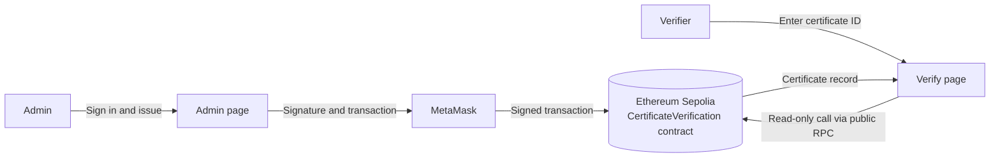

# Certificate Verification System using Ethereum Smart Contracts

A decentralized application (DApp) that lets an institution issue academic certificates on the Ethereum blockchain and lets anyone, anywhere, verify a certificate's authenticity using its certificate ID. No central database, no login and no wallet is needed to verify.

> **Network:** Sepolia test network (Ethereum)
> **Contract:** [`0xBb612153C9bAe0bd0B1f8ED71910CC10dC6A1529`](https://sepolia.etherscan.io/address/0xBb612153C9bAe0bd0B1f8ED71910CC10dC6A1529)

---

## Table of Contents

1. [Overview](#1-overview)
2. [Problem Statement](#2-problem-statement)
3. [Proposed Solution](#3-proposed-solution)
4. [Features](#4-features)
5. [System Architecture](#5-system-architecture)
6. [Technology Stack](#6-technology-stack)
7. [Project Structure](#7-project-structure)
8. [Smart Contract Details](#8-smart-contract-details)
9. [Website Pages](#9-website-pages)
10. [How Admin Login Works](#10-how-admin-login-works)
11. [Deployed Contract Information](#11-deployed-contract-information)
12. [Prerequisites](#12-prerequisites)
13. [Setup and Installation](#13-setup-and-installation)
14. [Running the Project](#14-running-the-project)
15. [Usage Guide](#15-usage-guide)
16. [Testing](#16-testing)
17. [Security Considerations](#17-security-considerations)
18. [Limitations](#18-limitations)
19. [Future Scope](#19-future-scope)
20. [Troubleshooting](#20-troubleshooting)
21. [Screenshots](#21-screenshots)
22. [Author](#22-author)
23. [License](#23-license)

---

## 1. Overview

Certificates are usually paper or PDF files that are easy to forge and slow to verify. This project stores certificate records on the **Ethereum blockchain** through a **smart contract**. Once a certificate is recorded, nobody can edit or delete it, including the institution. Anyone can verify it instantly by entering the certificate ID, and the answer is read straight from the blockchain.

## 2. Problem Statement

- Fake and tampered certificates are a common problem for employers and universities.
- Verifying a certificate normally means contacting the issuing institution, which is slow and manual.
- A traditional database is controlled by one party and can be edited, deleted or hacked, so a verifier must simply trust the institution's records.

## 3. Proposed Solution

- The institution (admin) issues certificates through a smart contract deployed on Ethereum.
- Each record (ID, student name, course, issue date and blockchain timestamp) is stored on-chain and cannot be altered afterwards.
- Only the admin wallet is allowed to issue certificates (enforced inside the contract).
- Anyone can verify a certificate for free through a public web page, with no account needed.

## 4. Features

**Public**
- Verify a certificate by its ID, with a clear **Valid** or **Invalid / Not Found** result.
- Shows student name, course, issue date and the time it was recorded on the blockchain.
- Shareable verification links, for example `verify.html?id=CERT001`.
- Works without MetaMask or any wallet, using a public Sepolia RPC.

**Admin**
- Passwordless admin login by signing a message with the institution's wallet (MetaMask).
- Access denied for any wallet that is not the contract owner.
- Issue new certificates from a dashboard.
- Dashboard lists every issued certificate with a link to its transaction on Etherscan.
- Automatic sign-out if the wallet account is switched.

**Smart contract**
- `onlyOwner` access control for issuing.
- Duplicate certificate IDs are rejected, so issued records can never be overwritten.
- Emits a `CertificateIssued` event for every certificate.

## 5. System Architecture



**Issue flow**
1. Admin opens the Admin page and signs a login message in MetaMask.
2. The page checks that the signing wallet equals the contract `owner()`.
3. Admin fills the issue form; the page asks MetaMask to send an `issueCertificate` transaction.
4. After the admin confirms and pays a small gas fee, the transaction is mined and the record becomes permanent.

**Verify flow**
1. A visitor opens the Verify page and enters a certificate ID.
2. The page calls `verifyCertificate` on the contract through a public RPC node (a free, read-only call).
3. The page shows Valid with the stored details, or Invalid / Not Found.

## 6. Technology Stack

| Layer | Technology |
| --- | --- |
| Blockchain | Ethereum, Sepolia test network |
| Smart contract | Solidity ^0.8.20 |
| Contract development and deployment | Remix IDE |
| Wallet | MetaMask browser extension |
| Front end | HTML, CSS, JavaScript |
| Blockchain library | ethers.js v6 (loaded from CDN) |
| Local server | VS Code Live Server extension |
| Block explorer | Sepolia Etherscan |

## 7. Project Structure

```
certi-project/
├── contracts/
│   └── CertificateVerification.sol   # Solidity smart contract
├── index.html                        # Home page
├── verify.html                       # Public certificate verification page
├── admin.html                        # Admin login and dashboard
├── config.js                         # Contract address, ABI, RPC settings
├── style.css                         # Shared styles
├── screenshots/                      # Project screenshots (add your own)
└── README.md                         # This file
```

## 8. Smart Contract Details

File: `contracts/CertificateVerification.sol`

**State**
- `address public owner`: the deployer, who is the only account allowed to issue certificates.
- `mapping(string => Certificate) private certificates`: certificate ID to its record.

**Certificate struct**

| Field | Type | Description |
| --- | --- | --- |
| `studentName` | string | Name of the student |
| `course` | string | Course or programme |
| `issueDate` | string | Issue date entered by the admin (YYYY-MM-DD) |
| `issuedAt` | uint256 | Block timestamp when the record was written |
| `exists` | bool | Marks that the certificate has really been issued |

**Functions**

| Function | Access | Cost | Purpose |
| --- | --- | --- | --- |
| `issueCertificate(certId, studentName, course, issueDate)` | Owner only | Gas | Stores a new certificate. Reverts if the ID is empty or already used |
| `verifyCertificate(certId)` | Anyone (`view`) | Free | Returns `valid`, `studentName`, `course`, `issueDate`, `issuedAt` |
| `owner()` | Anyone (`view`) | Free | Returns the admin address |

**Event**
- `CertificateIssued(string certId, string studentName, string course, uint256 timestamp)`

**Revert messages**
- `Only the institution can issue certificates`
- `Certificate ID required`
- `Certificate ID already exists`

## 9. Website Pages

| Page | File | Who can use it | Description |
| --- | --- | --- | --- |
| Home | `index.html` | Everyone | Entry page with links to Verify and Admin Login |
| Verify | `verify.html` | Everyone, no wallet needed | Enter an ID to see if the certificate is valid |
| Admin | `admin.html` | Admin wallet only | Wallet-signature login, issue form, list of issued certificates, logout |

## 10. How Admin Login Works

There is no username or password.

1. Admin clicks **Connect MetaMask and Sign In**.
2. The page reads `owner()` from the contract and compares it with the connected wallet.
3. If it matches, MetaMask asks the admin to **sign a message** (free, no transaction).
4. The page recovers the signer from the signature with `ethers.verifyMessage` and checks it equals the owner.
5. The dashboard opens. Switching accounts in MetaMask signs the admin out automatically.

A wallet that is not the owner sees **Access denied** and the dashboard stays hidden.

> The page check only controls what the interface shows. The real security is the `onlyOwner` check inside the smart contract, so a non-admin cannot issue certificates even by bypassing the page.

## 11. Deployed Contract Information

| Item | Value |
| --- | --- |
| Network | Sepolia (chain ID 11155111) |
| Contract address | `0xBb612153C9bAe0bd0B1f8ED71910CC10dC6A1529` |
| Etherscan | https://sepolia.etherscan.io/address/0xBb612153C9bAe0bd0B1f8ED71910CC10dC6A1529 |
| Sample certificate | `CERT001`, issued in transaction `0x83ffee40fd8afbd437e684f2bc1ca0c1a28957d16d4ede2fe4d7217d590c54d9` |

## 12. Prerequisites

- A Chromium-based browser such as Brave, Chrome or Edge
- [MetaMask](https://metamask.io/download/) extension
- [Visual Studio Code](https://code.visualstudio.com/) with the **Live Server** extension (by Ritwick Dey)
- Sepolia test ETH (free, from a faucet) if you deploy your own contract
- An internet connection

## 13. Setup and Installation

### Option A: Use the already deployed contract (quickest)

1. Clone the repository:
   ```bash
   git clone <your-repository-url>
   cd <repository-folder>
   ```
2. Open the folder in VS Code.
3. `config.js` already points to the deployed contract, so no change is needed.
4. Continue to [Running the Project](#14-running-the-project).

To use the **Admin** page you must hold the wallet that deployed the contract. Anyone can use the **Verify** page.

### Option B: Deploy your own copy of the contract

1. **Install MetaMask** and create a wallet. Write the 12-word recovery phrase on paper and never share it.
2. **Add the Sepolia network**: in MetaMask enable *Show test networks* and select **Sepolia**.
3. **Get test ETH** from a Sepolia faucet. About 0.02 test ETH is enough.
4. **Deploy with Remix**:
   1. Open [remix.ethereum.org](https://remix.ethereum.org).
   2. Create `CertificateVerification.sol` and paste the contract code from `contracts/`.
   3. Open the **Solidity Compiler** tab, choose version 0.8.20 or higher and click **Compile**.
   4. Open **Deploy and Run Transactions**, set **Environment** to **Browser Extension** (MetaMask) and make sure the network shows Sepolia.
   5. Click **Deploy** and confirm in MetaMask.
   6. Copy the contract address from **Deployed Contracts**.
5. **Configure the website**: open `config.js` and replace the value of `CONTRACT_ADDRESS` with your new address.
6. Optional: set `DEPLOY_BLOCK` in `config.js` to your contract's deployment block number to make the admin list load faster.

## 14. Running the Project

1. Open the project folder in VS Code.
2. Right-click `index.html` and choose **Open with Live Server**.
3. The site opens at `http://127.0.0.1:5500/index.html`.
4. Use a browser that has MetaMask installed (for example Brave) for the Admin page.

The site must be served over `http://localhost` or `http://127.0.0.1`. Opening the files directly with `file://` can stop MetaMask from connecting.

## 15. Usage Guide

**Verify a certificate (anyone)**
1. Open the **Verify** page.
2. Enter a certificate ID, for example `CERT001`, and click **Verify**.
3. A green box means the certificate exists on the blockchain; a red box means it does not.
4. Use **Copy link** to share the result.

**Issue a certificate (admin)**
1. Open **Admin Login**, click **Connect MetaMask and Sign In** and approve the signature request.
2. On the dashboard fill in Certificate ID, Student Name, Course and Issue Date.
3. Click **Issue Certificate** and confirm the transaction in MetaMask.
4. After confirmation, the certificate appears in the **Issued Certificates** list.
5. Click **Logout** when finished.

## 16. Testing

The following scenarios were tested on Sepolia:

| Scenario | Expected result | Result |
| --- | --- | --- |
| Verify an existing ID (`CERT001`) | Valid with details | Pass |
| Verify an unknown ID | Invalid / Not Found | Pass |
| Open a shared link `verify.html?id=CERT001` | Result shown automatically | Pass |
| Admin signs in with the owner wallet | Dashboard opens | Pass |
| Sign in with a different wallet | Access denied | Pass |
| Issue a new certificate | Transaction confirmed, listed in dashboard | Pass |
| Issue an existing ID again | Fails with `Certificate ID already exists` | Pass |
| Switch MetaMask account while signed in | Automatic logout | Pass |

Approximate cost on Sepolia: about 0.009 test ETH to deploy and about 0.0009 test ETH per certificate (test coins have no real value).

## 17. Security Considerations

- **Access control:** `onlyOwner` in the contract is the real lock for issuing.
- **No passwords:** admin identity is proven by a wallet signature; the private key never leaves MetaMask.
- **Immutability:** records cannot be edited or deleted after issue, and duplicate IDs are rejected.
- **No funds held:** the contract never holds or sends ETH, so reentrancy and fund-theft risks do not apply.
- **Output escaping:** data read from the blockchain is escaped before it is shown on the page.
- **Wallet safety:** never share your recovery phrase or private key. This repository contains no keys or secrets, only the public contract address.

## 18. Limitations

- Certificate details are stored in plain text, so they are public on the blockchain. A production system should store only a hash.
- No revoke or correction function; a wrong certificate stays on-chain.
- Single admin wallet; losing the key means no new certificates can be issued.
- Certificate files (PDF) are not linked to the on-chain record.
- Deployed on a test network and served locally, not on a hosted site.
- Verification is by certificate ID only.

## 19. Future Scope

- Store only a hash of the certificate and keep files on IPFS, so verification can be done by uploading the file.
- Add a revoke function and support for multiple issuers with role management.
- Multi-signature or hardware wallet for the admin account.
- QR code on each certificate that opens the verification page.
- Deploy on a low-cost layer-2 network (such as Polygon) and host the website publicly.
- Bulk issuing from a CSV file and email notifications.
- Ownership-transfer function and contract upgradeability for production use.

## 20. Troubleshooting

| Problem | Fix |
| --- | --- |
| Page changes do not show | Hard refresh with `Ctrl + Shift + R` |
| MetaMask not found | Use a browser with the MetaMask extension and open the site via Live Server |
| Admin page says Access denied | You are connected with a wallet that is not the contract owner; switch to the deploying account |
| MetaMask keeps using the wrong account | Disconnect the site in MetaMask, switch account, then connect again |
| Transaction fails with insufficient funds | Get more Sepolia test ETH from a faucet |
| Wrong network | Switch MetaMask to Sepolia |
| Verify page says it could not reach the blockchain | Check your internet connection and try again |
| List is empty right after issuing | Click **Refresh**; the public node can lag a few seconds |
| Pages break after redeploying the contract | Update `CONTRACT_ADDRESS` in `config.js` |

## 21. Screenshots

Add your screenshots to the `screenshots/` folder and link them here, for example:

```markdown


```

## 22. Author

- **Name:** _your name_
- **Course / Institution:** _your course and college_
- **Mentor:** _your mentor's name_

## 23. License

This project was created for academic purposes. Add a license of your choice, for example the [MIT License](https://opensource.org/licenses/MIT).
