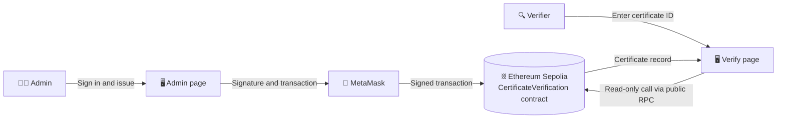

<div align="center">


<a href="https://git.io/typing-svg"></a>

<br/>


<br/>

> 🌐 **Network:** Sepolia Test Network &nbsp;|&nbsp; 📜 **Contract:** [`0xBb61...1529`](https://sepolia.etherscan.io/address/0xBb612153C9bAe0bd0B1f8ED71910CC10dC6A1529)

</div>


## 📚 Table of Contents

| | | | |
| :-- | :-- | :-- | :-- |
| [🌊 Overview](#-overview) | [🚨 Problem](#-problem-statement) | [💡 Solution](#-proposed-solution) | [✨ Features](#-features) |
| [🏗️ Architecture](#%EF%B8%8F-system-architecture) | [🧰 Tech Stack](#-technology-stack) | [📁 Structure](#-project-structure) | [📜 Contract](#-smart-contract-details) |
| [🖥️ Pages](#%EF%B8%8F-website-pages) | [🔑 Admin Login](#-how-admin-login-works) | [🚀 Deployed](#-deployed-contract-information) | [✅ Prerequisites](#-prerequisites) |
| [⚙️ Setup](#%EF%B8%8F-setup-and-installation) | [▶️ Run](#%EF%B8%8F-running-the-project) | [📖 Usage](#-usage-guide) | [🧪 Testing](#-testing) |
| [🛡️ Security](#%EF%B8%8F-security-considerations) | [⚠️ Limits](#%EF%B8%8F-limitations) | [🔮 Future](#-future-scope) | [🩹 Troubleshooting](#-troubleshooting) |

<br/>

## 🌊 Overview

Certificates are usually paper or PDF files that are easy to forge and slow to verify. This project stores certificate records on the **Ethereum blockchain** through a **smart contract**.

- 🔒 Once recorded, a certificate **cannot be edited or deleted**, not even by the institution.
- ⚡ Anyone can verify it **instantly** with a certificate ID.
- ⛓️ The answer is read **straight from the blockchain**. No central database, no login, no wallet needed to verify.

## 🚨 Problem Statement

- 🎭 Fake and tampered certificates are a common problem for employers and universities.
- 🐢 Verifying normally means contacting the institution, which is slow and manual.
- 🗄️ A traditional database is controlled by one party and can be edited, deleted or hacked, so verifiers must simply trust it.

## 💡 Proposed Solution

- 🏫 The institution (admin) issues certificates through a smart contract on Ethereum.
- 🧾 Each record (ID, student name, course, issue date, blockchain timestamp) is stored on-chain and cannot be altered.
- 🔐 Only the admin wallet can issue certificates, enforced inside the contract.
- 🌍 Anyone can verify for free through a public web page, with no account.

## ✨ Features

<table>
<tr>
<td width="33%" valign="top">

### 🌐 Public
- ✅ Verify by certificate ID with a clear **Valid** or **Invalid / Not Found** result
- 👤 Shows student name, course, issue date and blockchain timestamp
- 🔗 Shareable links, e.g. `verify.html?id=CERT001`
- 🦊 No MetaMask needed, uses a public Sepolia RPC

</td>
<td width="33%" valign="top">

### 🛠️ Admin
- ✍️ Passwordless login by signing a message with MetaMask
- ⛔ Access denied for any non-owner wallet
- 📝 Issue certificates from a dashboard
- 📋 List of all issued certificates with Etherscan links
- 🔄 Auto sign-out when the wallet account changes

</td>
<td width="33%" valign="top">

### 📜 Smart Contract
- 🔑 `onlyOwner` access control for issuing
- 🚫 Duplicate IDs rejected, records never overwritten
- 📣 `CertificateIssued` event emitted for every certificate

</td>
</tr>
</table>

## 🏗️ System Architecture



<table>
<tr>
<td width="50%" valign="top">

**📝 Issue flow**
1. Admin opens the Admin page and signs a login message in MetaMask.
2. The page checks the signing wallet equals the contract `owner()`.
3. Admin fills the issue form; MetaMask sends an `issueCertificate` transaction.
4. After confirming and paying a small gas fee, the transaction is mined and the record becomes permanent.

</td>
<td width="50%" valign="top">

**🔍 Verify flow**
1. A visitor opens the Verify page and enters a certificate ID.
2. The page calls `verifyCertificate` through a public RPC node (free, read-only).
3. The page shows **Valid** with stored details, or **Invalid / Not Found**.

</td>
</tr>
</table>

## 🧰 Technology Stack

| Layer | Technology |
| :-- | :-- |
| ⛓️ Blockchain | Ethereum, Sepolia test network |
| 📜 Smart contract | Solidity ^0.8.20 |
| 🧪 Development and deployment | Remix IDE |
| 🦊 Wallet | MetaMask browser extension |
| 🎨 Front end | HTML, CSS, JavaScript |
| 📚 Blockchain library | ethers.js v6 (CDN) |
| 💻 Local server | VS Code Live Server extension |
| 🔎 Block explorer | Sepolia Etherscan |

## 📁 Project Structure

```
Etherum-project---certification-/
├── 📜 CertificateVerification.sol   # Solidity smart contract
├── 🏠 index.html                    # Home page
├── 🔍 verify.html                   # Public certificate verification page
├── 🛠️ admin.html                    # Admin login and dashboard
├── ⚙️ config.js                     # Contract address, ABI, RPC settings
├── 🎨 style.css                     # Shared styles
├── 🖼️ screenshots/                  # Project screenshots (add your own)
└── 📘 README.md                     # This file
```

## 📜 Smart Contract Details

File: `CertificateVerification.sol`

**State**
- `address public owner`: the deployer, the only account allowed to issue certificates.
- `mapping(string => Certificate) private certificates`: certificate ID to its record.

**Certificate struct**

| Field | Type | Description |
| :-- | :-- | :-- |
| `studentName` | string | Name of the student |
| `course` | string | Course or programme |
| `issueDate` | string | Issue date entered by the admin (YYYY-MM-DD) |
| `issuedAt` | uint256 | Block timestamp when the record was written |
| `exists` | bool | Marks that the certificate has really been issued |

**Functions**

| Function | Access | Cost | Purpose |
| :-- | :-- | :-- | :-- |
| `issueCertificate(certId, studentName, course, issueDate)` | 🔐 Owner only | ⛽ Gas | Stores a new certificate. Reverts if ID is empty or already used |
| `verifyCertificate(certId)` | 🌍 Anyone (`view`) | 🆓 Free | Returns `valid`, `studentName`, `course`, `issueDate`, `issuedAt` |
| `owner()` | 🌍 Anyone (`view`) | 🆓 Free | Returns the admin address |

**📣 Event:** `CertificateIssued(string certId, string studentName, string course, uint256 timestamp)`

**❌ Revert messages**
- `Only the institution can issue certificates`
- `Certificate ID required`
- `Certificate ID already exists`

## 🖥️ Website Pages

| Page | File | Who can use it | Description |
| :-- | :-- | :-- | :-- |
| 🏠 Home | `index.html` | Everyone | Entry page with links to Verify and Admin Login |
| 🔍 Verify | `verify.html` | Everyone, no wallet | Enter an ID to see if the certificate is valid |
| 🛠️ Admin | `admin.html` | Admin wallet only | Signature login, issue form, issued list, logout |

## 🔑 How Admin Login Works

> There is no username or password. 🚫🔤

1. 🦊 Admin clicks **Connect MetaMask and Sign In**.
2. 🔎 The page reads `owner()` from the contract and compares it with the connected wallet.
3. ✍️ If it matches, MetaMask asks to **sign a message** (free, no transaction).
4. ✅ The page recovers the signer with `ethers.verifyMessage` and checks it equals the owner.
5. 🎉 The dashboard opens. Switching accounts in MetaMask signs the admin out automatically.

A wallet that is not the owner sees **Access denied** and the dashboard stays hidden.

> 🛡️ The page check only controls what the interface shows. The real security is the `onlyOwner` check inside the smart contract, so a non-admin cannot issue certificates even by bypassing the page.

## 🚀 Deployed Contract Information

| Item | Value |
| :-- | :-- |
| 🌐 Network | Sepolia (chain ID 11155111) |
| 📜 Contract address | `0xBb612153C9bAe0bd0B1f8ED71910CC10dC6A1529` |
| 🔎 Etherscan | [View contract](https://sepolia.etherscan.io/address/0xBb612153C9bAe0bd0B1f8ED71910CC10dC6A1529) |
| 🧾 Sample certificate | `CERT001`, tx `0x83ffee40fd8afbd437e684f2bc1ca0c1a28957d16d4ede2fe4d7217d590c54d9` |

## ✅ Prerequisites

- 🌐 Chromium-based browser such as Brave, Chrome or Edge
- 🦊 [MetaMask](https://metamask.io/download/) extension
- 💻 [Visual Studio Code](https://code.visualstudio.com/) with **Live Server** extension (by Ritwick Dey)
- 💧 Sepolia test ETH (free, from a faucet) if you deploy your own contract
- 📶 Internet connection

## ⚙️ Setup and Installation

<details open>
<summary><b>⚡ Option A: Use the already deployed contract (quickest)</b></summary>

<br/>

1. Clone the repository:
   ```bash
   git clone git@github.com:AbhishekTC-stack/Etherum-project---certification-.git
   cd Etherum-project---certification-
   ```
2. Open the folder in VS Code.
3. `config.js` already points to the deployed contract, no change needed.
4. Continue to [Running the Project](#%EF%B8%8F-running-the-project).

> Admin page needs the wallet that deployed the contract. Verify page works for anyone.

</details>

<details>
<summary><b>🛠️ Option B: Deploy your own copy of the contract</b></summary>

<br/>

1. **Install MetaMask** and create a wallet. Write the 12-word recovery phrase on paper and never share it.
2. **Add Sepolia**: in MetaMask enable *Show test networks* and select **Sepolia**.
3. **Get test ETH** from a Sepolia faucet. About 0.02 test ETH is enough.
4. **Deploy with Remix**:
   1. Open [remix.ethereum.org](https://remix.ethereum.org).
   2. Create `CertificateVerification.sol` and paste the contract code.
   3. Open **Solidity Compiler**, choose version 0.8.20 or higher, click **Compile**.
   4. Open **Deploy and Run Transactions**, set **Environment** to **Browser Extension** (MetaMask), network must show Sepolia.
   5. Click **Deploy** and confirm in MetaMask.
   6. Copy the contract address from **Deployed Contracts**.
5. **Configure the website**: in `config.js` replace `CONTRACT_ADDRESS` with your new address.
6. Optional: set `DEPLOY_BLOCK` in `config.js` to your deployment block number so the admin list loads faster.

</details>

## ▶️ Running the Project

1. Open the project folder in VS Code.
2. Right-click `index.html` and choose **Open with Live Server**.
3. Site opens at `http://127.0.0.1:5500/index.html`.
4. Use a browser with MetaMask installed (for example Brave) for the Admin page.

> ⚠️ Serve over `http://localhost` or `http://127.0.0.1`. Opening files directly with `file://` can stop MetaMask from connecting.

## 📖 Usage Guide

<table>
<tr>
<td width="50%" valign="top">

**🔍 Verify a certificate (anyone)**
1. Open the **Verify** page.
2. Enter an ID, e.g. `CERT001`, click **Verify**.
3. 🟢 Green box = exists on the blockchain. 🔴 Red box = does not.
4. Use **Copy link** to share the result.

</td>
<td width="50%" valign="top">

**📝 Issue a certificate (admin)**
1. Open **Admin Login**, click **Connect MetaMask and Sign In**, approve the signature.
2. Fill in Certificate ID, Student Name, Course, Issue Date.
3. Click **Issue Certificate** and confirm in MetaMask.
4. Certificate appears in **Issued Certificates**.
5. Click **Logout** when finished.

</td>
</tr>
</table>

## 🧪 Testing

Scenarios tested on Sepolia:

| Scenario | Expected result | Result |
| :-- | :-- | :-: |
| Verify an existing ID (`CERT001`) | Valid with details | ✅ Pass |
| Verify an unknown ID | Invalid / Not Found | ✅ Pass |
| Open shared link `verify.html?id=CERT001` | Result shown automatically | ✅ Pass |
| Admin signs in with owner wallet | Dashboard opens | ✅ Pass |
| Sign in with a different wallet | Access denied | ✅ Pass |
| Issue a new certificate | Transaction confirmed, listed in dashboard | ✅ Pass |
| Issue an existing ID again | Fails with `Certificate ID already exists` | ✅ Pass |
| Switch MetaMask account while signed in | Automatic logout | ✅ Pass |

💸 Approximate cost on Sepolia: about 0.009 test ETH to deploy and about 0.0009 test ETH per certificate (test coins have no real value).

## 🛡️ Security Considerations

- 🔐 **Access control:** `onlyOwner` in the contract is the real lock for issuing.
- 🚫 **No passwords:** admin identity proven by wallet signature; private key never leaves MetaMask.
- 🧊 **Immutability:** records cannot be edited or deleted, duplicate IDs rejected.
- 💰 **No funds held:** contract never holds or sends ETH, so reentrancy and fund-theft risks do not apply.
- 🧼 **Output escaping:** blockchain data is escaped before display.
- 🗝️ **Wallet safety:** never share your recovery phrase or private key. This repository contains no keys or secrets, only the public contract address.

## ⚠️ Limitations

- 👁️ Details stored in plain text, so public on the blockchain. Production should store only a hash.
- 🔙 No revoke or correction function; a wrong certificate stays on-chain.
- 👤 Single admin wallet; losing the key means no new certificates.
- 📄 Certificate files (PDF) not linked to the on-chain record.
- 🧪 Test network and local server only, not a hosted site.
- 🔢 Verification by certificate ID only.

## 🔮 Future Scope

- [ ] 🧬 Store only a hash and keep files on IPFS, verify by uploading the file
- [ ] 🚫 Revoke function and multiple issuers with role management
- [ ] 🔏 Multi-signature or hardware wallet for admin
- [ ] 📱 QR code on each certificate linking to the verify page
- [ ] 🌍 Deploy on a low-cost layer-2 (such as Polygon) and host the site publicly
- [ ] 📦 Bulk issuing from CSV and email notifications
- [ ] 🔄 Ownership transfer and contract upgradeability

## 🩹 Troubleshooting

<details>
<summary><b>Click to open the fix table</b></summary>

<br/>

| Problem | Fix |
| :-- | :-- |
| Page changes do not show | Hard refresh with `Ctrl + Shift + R` |
| MetaMask not found | Use a browser with MetaMask and open the site via Live Server |
| Admin says Access denied | Wallet is not the contract owner; switch to the deploying account |
| MetaMask uses wrong account | Disconnect the site in MetaMask, switch account, connect again |
| Transaction fails, insufficient funds | Get more Sepolia test ETH from a faucet |
| Wrong network | Switch MetaMask to Sepolia |
| Verify page cannot reach blockchain | Check internet connection and retry |
| List empty right after issuing | Click **Refresh**; public node can lag a few seconds |
| Pages break after redeploying | Update `CONTRACT_ADDRESS` in `config.js` |

</details>

## 🖼️ Screenshots

Add images to the `screenshots/` folder and link them:

```markdown


```

## 👨‍💻 Author

- **GitHub:** [@AbhishekTC-stack](https://github.com/AbhishekTC-stack)
- **Course / Institution:** _your course and college_
- **Mentor:** _your mentor's name_

## 📄 License

Created for academic purposes. Add a license of your choice, for example the [MIT License](https://opensource.org/licenses/MIT).

<br/>

<div align="center">

⭐ **Star this repo if it helped you!** ⭐


</div>
